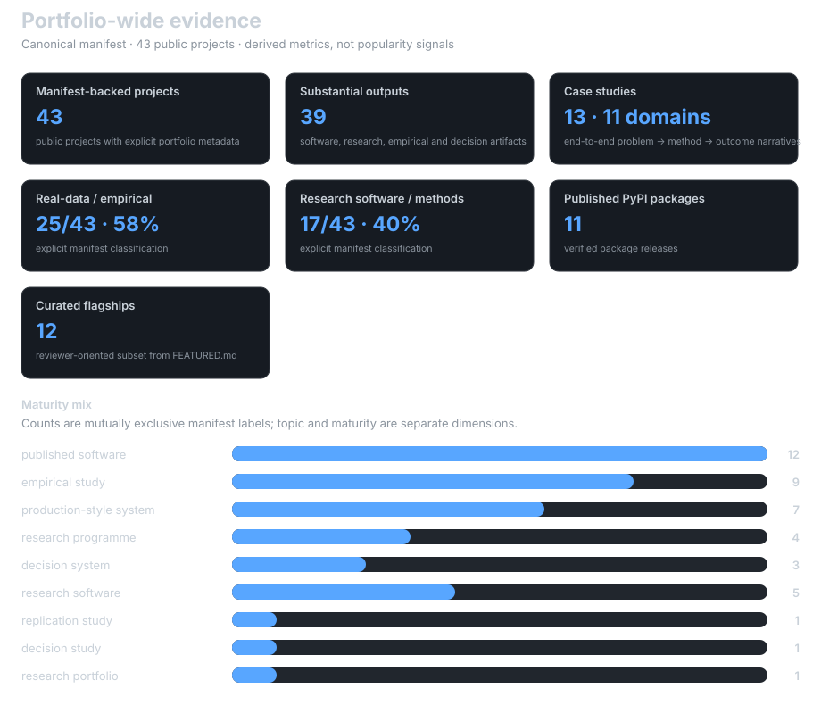
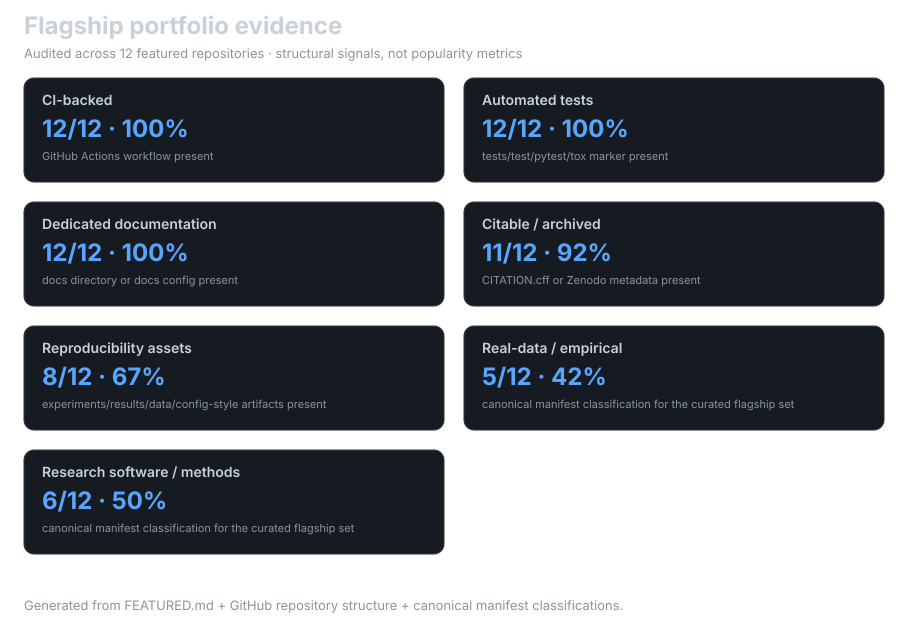
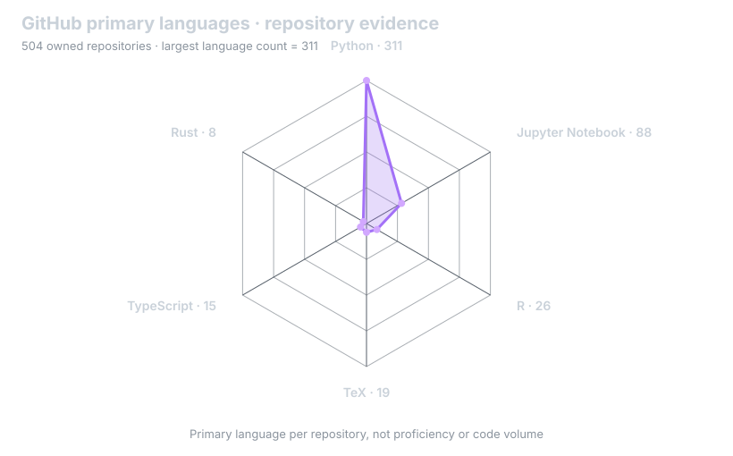
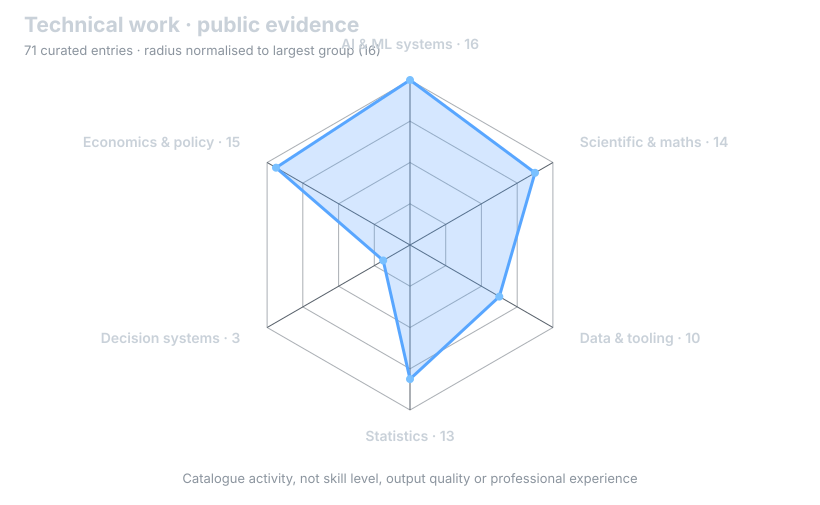
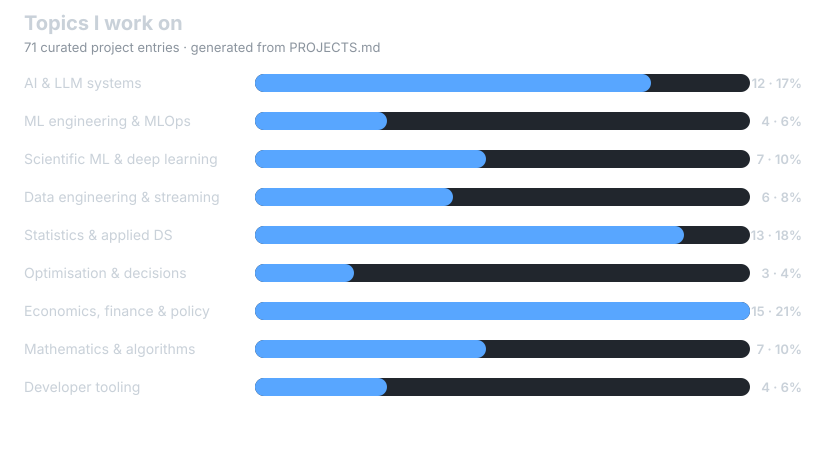
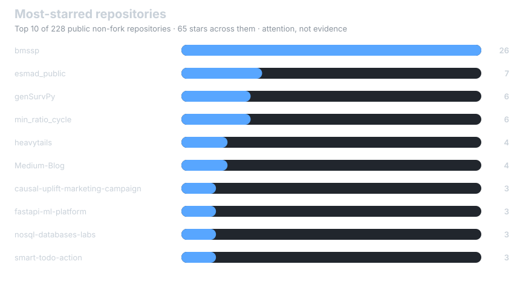

  
  
  
  
  
  

---

# Statistics

Quantitative evidence about the portfolio: scale, empirical depth, publication/output depth, reproducibility controls, delivered impact and secondary GitHub activity signals.

## Repository Visibility and Evidence Boundaries

**Account-wide snapshot (29 October 2026):** authenticated GitHub owner-affiliation inventory, paginated to an empty page and deduplicated by repository ID. It includes archived repositories and is distinct from the curated, manifest-backed public portfolio.

| Visibility | All owned repositories | Archived subset | Publicly inspectable here? |
| :-- | --: | --: | :-- |
| Public | **240** | 5 | Yes, subject to individual repository contents and access |
| Private | **264** | 1 | No; only aggregate visibility metadata is disclosed |
| **Combined** | **504** | **6** | Not a measure of research quality or professional experience |

The counts come from an authenticated GitHub inventory on the stated date, not from a publicly reproducible API query. They are **point-in-time ownership and visibility counts**, not claims about code quality, completeness, active development, originality or deployment. The private count cannot be independently verified by anonymous visitors. This section does not expose private repository names, descriptions, links, languages, contributors, timestamps or repository-level metadata. The published [aggregate snapshot](data/repository_visibility_snapshot.json) includes only counts and collection-method metadata; it must be refreshed deliberately with authenticated access rather than guessed from public GitHub statistics.

### Public evidence: inspectable examples

The selected examples below link to public source or specific implementation artifacts. Inclusion shows that a reviewer can inspect the work, not that every claim has been independently replicated.

| Evidence area | Public repository | Inspectable evidence |
| :-- | :-- | :-- |
| Production AI and evaluation | [feedback-intelligence-agent](https://github.com/DiogoRibeiro7/feedback-intelligence-agent) | [Retrieval/evaluation benchmark](https://github.com/DiogoRibeiro7/feedback-intelligence-agent/blob/main/scripts/benchmark.py) |
| Forecasting and decision systems | [clinic-forecasting-platform](https://github.com/DiogoRibeiro7/clinic-forecasting-platform) | [Staffing policy benchmark](https://github.com/DiogoRibeiro7/clinic-forecasting-platform/blob/main/scripts/run_hybrid_policy_benchmark.py) |
| Data engineering and temporal validation | [transaction-risk-lakehouse](https://github.com/DiogoRibeiro7/transaction-risk-lakehouse) | [Spark model benchmark](https://github.com/DiogoRibeiro7/transaction-risk-lakehouse/blob/main/src/transaction_risk/experiments/benchmark.py) |
| Statistical methods and research software | [genSurvPy](https://github.com/DiogoRibeiro7/genSurvPy) | [Study reproduction entrypoint](https://github.com/DiogoRibeiro7/genSurvPy/blob/main/research/discrimination-not-calibration/scripts/reproduce.py) |
| Change-point analysis | [ChangePointLab](https://github.com/DiogoRibeiro7/ChangePointLab) | [Reproduction notebook](https://github.com/DiogoRibeiro7/ChangePointLab/blob/main/docs/notebooks/within_period_reproduction.ipynb) |
| Empirical spatial analysis | [lisbon-spatial-dynamics](https://github.com/DiogoRibeiro7/lisbon-spatial-dynamics) | [Spatial sensitivity analysis](https://github.com/DiogoRibeiro7/lisbon-spatial-dynamics/blob/main/scripts/analyse_housing_spatial_sensitivity.py) |

For broader coverage, see [Projects](PROJECTS.md), [Case Studies](CASE_STUDIES.md), [Outputs](OUTPUTS.md), and the [flagship reproducibility index](#reproducibility-evidence-index). The private inventory is not mixed into any of those public-project denominators.

---

## Portfolio Snapshot

<!-- statistics:snapshot:start -->
| Portfolio signal | Current value |
| :-- | --: |
| Manifest-backed public projects | **43** |
| Substantial outputs | **39** |
| Case studies | **16 across 14 domains** |
| Published PyPI packages | **11** |
| Real-data / empirical projects | **25 / 43 (58%)** |
| Research software / methods | **17 / 43 (40%)** |
| Curated flagship repositories | **12** |
| Curated catalogue entries | **71** |
<!-- statistics:snapshot:end -->

These figures intentionally use different populations for different questions. The denominator rules are explicit below rather than blending repository counts, output counts and catalogue entries into one headline number.

---

## Portfolio-Wide Evidence

<!-- statistics:denominator:start -->
**Primary denominator:** the **43 public projects represented in the canonical [`data/portfolio.json`](data/portfolio.json) manifest**. This is broader than the 12-project Featured subset and narrower than every repository ever created on the account.
<!-- statistics:denominator:end -->

  

### Research and output depth

<!-- statistics:depth:start -->
| Measure | Current scope | What it means |
| :-- | --: | :-- |
| Manifest-backed public projects | **43** | Projects with explicit category, maturity and evidence metadata |
| Substantial outputs | **39** | Published software, research programmes, empirical/replication studies, and decision/engineering artifacts |
| Published PyPI packages | **11** | Verified package releases, not merely package-ready repositories |
| Real-data / empirical projects | **25 / 43 (58%)** | Explicitly classified in the manifest |
| Research software / methods | **17 / 43 (40%)** | Explicitly classified libraries, methods and research tooling |
| Case studies | **16 across 14 domains** | End-to-end problem → constraints → method → outcome narratives |
| Curated flagship projects | **12** | Reviewer-oriented subset; deliberately not used as the portfolio denominator |
<!-- statistics:depth:end -->

### Output composition

<!-- statistics:outputs-intro:start -->
The **39 outputs** currently break down into:
<!-- statistics:outputs-intro:end -->

<!-- statistics:outputs:start -->
| Output class | Count |
| :-- | --: |
| Published research software | **11** |
| Research and paper programmes | **5** |
| Empirical and replication studies | **10** |
| Decision and engineering artifacts | **13** |
<!-- statistics:outputs:end -->

This is an artifact count, not a repository count: a repository can legitimately produce more than one inspectable output.

The **11 PyPI packages** and **11 published research-software outputs** are separate measures, even though their current totals happen to match. The PyPI figure counts projects with recorded package releases; the output figure counts records classified as published research software in the curated output inventory. For example, **DataExcept** is included in the PyPI total, while its output is classified under decision and engineering artifacts. **ChangePointLab** is included as a published research-software output with archive metadata, but has no PyPI package recorded in the manifest. Neither category requires a software DOI or implies that unrelated preprint-stage code must be made public.

---

## Delivered Impact

The following figures are reported outcomes from professional industry work, not measurements derived from the public repositories. The underlying commercial baselines, measurement windows and source records are not published in this portfolio, so these figures should not be treated as independently reproducible from GitHub. They are kept separate from repository metrics because GitHub activity is not a proxy for professional delivery.

| Delivered outcome | Result |
| :-- | --: |
| Reporting cost reduction | **80%** |
| Analytics processing-time reduction | **30%** |
| Inventory-value reduction through forecasting and operational optimisation | **€500K** |

---

## Flagship Engineering Controls

**Denominator:** the **12 projects in [`FEATURED.md`](FEATURED.md)**. This smaller set is used only for repository-structure auditing, where a consistent manual/automated check is useful.

  

Current structural evidence across those 12 flagships:

<!-- statistics:controls:start -->
| Control | Coverage |
| :-- | --: |
| CI workflow present | **12 / 12 (100%)** |
| Automated-test marker present | **12 / 12 (100%)** |
| Dedicated documentation | **12 / 12 (100%)** |
| Citation / archive metadata | **11 / 12 (92%)** |
| Reproducibility-style assets | **12 / 12 (100%)** |
<!-- statistics:controls:end -->

These are structural controls, not claims that every project is scientifically valid or production-ready. The reproducibility row now counts a curated, nonempty tracked artifact in each flagship repository; it does not assert that the artifact was executed successfully, that all inputs are available, or that a paper was replicated independently.

### Reproducibility evidence index

The following references identify one concrete artifact per flagship repository and describe its scope or dependencies. A source file, notebook, configuration, or fixture is evidence of an inspectable reproducibility pathway, not a successful independent rerun.

<!-- statistics:reproducibility-index:start -->
| Flagship repository | Reference artifact | What it demonstrates / requires |
| :-- | :-- | :-- |
| [feedback-intelligence-agent](https://github.com/DiogoRibeiro7/feedback-intelligence-agent) | [RAG benchmarking script](https://github.com/DiogoRibeiro7/feedback-intelligence-agent/blob/main/scripts/benchmark.py) | Local retrieval/evaluation driver; example dataset and provider configuration determine the run |
| [clinic-forecasting-platform](https://github.com/DiogoRibeiro7/clinic-forecasting-platform) | [Hybrid-policy benchmark](https://github.com/DiogoRibeiro7/clinic-forecasting-platform/blob/main/scripts/run_hybrid_policy_benchmark.py) | Synthetic-data staffing experiment with separately documented decision and coverage limits |
| [transaction-risk-lakehouse](https://github.com/DiogoRibeiro7/transaction-risk-lakehouse) | [Spark model benchmark](https://github.com/DiogoRibeiro7/transaction-risk-lakehouse/blob/main/src/transaction_risk/experiments/benchmark.py) | Temporal risk-model evaluation implementation; demo data and local Spark required |
| [genSurvPy](https://github.com/DiogoRibeiro7/genSurvPy) | [Study reproduction entrypoint](https://github.com/DiogoRibeiro7/genSurvPy/blob/main/research/discrimination-not-calibration/scripts/reproduce.py) | Pilot and locked-production orchestration for simulation, aggregation, tables and figures |
| [setqca-python](https://github.com/DiogoRibeiro7/setqca-python) | [R reference fixture generator](https://github.com/DiogoRibeiro7/setqca-python/blob/main/validation/r/generate_fixtures.R) | Cross-language parity fixtures; R QCA and jsonlite required when regenerating |
| [ChangePointLab](https://github.com/DiogoRibeiro7/ChangePointLab) | [Reproduction notebook](https://github.com/DiogoRibeiro7/ChangePointLab/blob/main/docs/notebooks/within_period_reproduction.ipynb) | Method comparison/reproduction notebook; execution depends on notebook environment |
| [population-resemblance](https://github.com/DiogoRibeiro7/population-resemblance) | [Published-table reproduction](https://github.com/DiogoRibeiro7/population-resemblance/blob/main/examples/reproduce_table2.py) | Deterministic verification of selected PRS calibration values and tolerances |
| [DataConsistencyChecker](https://github.com/DiogoRibeiro7/DataConsistencyChecker) | [OpenML-backed demonstration](https://github.com/DiogoRibeiro7/DataConsistencyChecker/blob/main/Demo%20Notebooks/Demo_Clear_Issues.ipynb) | Executable notebook demonstrating pattern checks; downloads the hypothyroid dataset from OpenML |
| [behavioral-sensing-research](https://github.com/DiogoRibeiro7/behavioral-sensing-research) | [Sensing simulation runner](https://github.com/DiogoRibeiro7/behavioral-sensing-research/blob/main/scripts/run_phase1_recoverable_gap.py) | Phase-one recoverable-information experiment; protocol and artifact assumptions documented in repository |
| [oisst-fourier-neural-operator](https://github.com/DiogoRibeiro7/oisst-fourier-neural-operator) | [NOAA baseline notebook](https://github.com/DiogoRibeiro7/oisst-fourier-neural-operator/blob/main/notebooks/05_baselines.ipynb) | Empirical SST forecasting baseline; NOAA data preparation and experiment environment required |
| [lisbon-spatial-dynamics](https://github.com/DiogoRibeiro7/lisbon-spatial-dynamics) | [Spatial sensitivity analysis](https://github.com/DiogoRibeiro7/lisbon-spatial-dynamics/blob/main/scripts/analyse_housing_spatial_sensitivity.py) | Geographic robustness procedure; official-data inputs and configured boundaries required |
| [energy-system-simulator](https://github.com/DiogoRibeiro7/energy-system-simulator) | [Storage-value experiment](https://github.com/DiogoRibeiro7/energy-system-simulator/blob/main/experiments/storage_value/scripts/run_experiment.py) | Configuration-backed power-system experiment with local input data |
<!-- statistics:reproducibility-index:end -->

---

## Topic Composition

### Programming languages across the full GitHub inventory

  

This radar uses **all 504 owned repositories** in the authenticated 29 October 2026 snapshot, including 240 public and 264 private repositories. For each repository, GitHub reports one *primary language* using its Linguist classification; this is not a count of all languages used, lines of code, depth of experience or skill level. In particular, GitHub classifies **Jupyter Notebook** separately from Python. The six leading classifications are displayed; **37 repositories** belong to other classifications or are unclassified.

| GitHub primary-language classification | Public | Private | Total |
| :-- | --: | --: | --: |
| Python | 122 | 189 | **311** |
| Jupyter Notebook | 58 | 30 | **88** |
| R | 16 | 10 | **26** |
| TeX | 7 | 12 | **19** |
| TypeScript | 9 | 6 | **15** |
| Rust | 6 | 2 | **8** |
| Other / unclassified | 22 | 15 | **37** |
| **Total** | **240** | **264** | **504** |

The radii are normalised to the largest language group (Python, 311), not to an arbitrary rating scale. The [aggregate language snapshot](data/repository_language_snapshot.json) contains counts only: no private repository identifiers or metadata. [`scripts/refresh_repository_inventory.py`](scripts/refresh_repository_inventory.py) regenerates both visibility and language snapshots from GitHub's authenticated repository metadata and then generates the SVG. Automatic remote refresh requires a dedicated token with access to the private repository inventory; the committed snapshot remains clearly dated until refreshed.

The [weekly refresh workflow](.github/workflows/repository-inventory.yml) requires a repository Actions secret named `PROFILE_INVENTORY_TOKEN` containing a fine-grained GitHub token with **read-only Metadata access to all owned public and private repositories**. The normal per-repository `GITHUB_TOKEN` is not sufficient for this account-wide inventory. The workflow runs offline checks without the secret, but does not refresh snapshots; with the secret, it proposes a PR when aggregate counts change. The refresh process never writes repository identities to the committed files.

### Public portfolio topic composition

### Technical work radar

  

The six axes group the same **71 curated entries** used in the topic chart below. Each entry belongs to one PROJECTS.md section and each section belongs to exactly one radar axis. The radius is `group count / largest group count`; the outer ring means *the largest group in this catalogue*, **not** a proficiency rating. Counts appear directly on the diagram. This measures documented public activity, not ability, project quality, time invested or private professional experience. The mapping is explicit in [`scripts/generate_evidence_radar.py`](scripts/generate_evidence_radar.py), and the SVG is regenerated from [`PROJECTS.md`](PROJECTS.md).

<!-- statistics:topic-intro:start -->
**Denominator:** the **71 curated entries in [`PROJECTS.md`](PROJECTS.md)**. Unlike the manifest dashboard above, this measures breadth of the catalogue rather than the maturity or evidential strength of each project.
<!-- statistics:topic-intro:end -->

  

Topic counts are therefore a **composition metric**, not a quality score and not an estimate of time spent or expertise level.

---

## Definitions and Boundaries

The page intentionally uses different denominators for different questions:

<!-- statistics:boundaries:start -->
| Question | Denominator |
| :-- | :-- |
| What does the serious public portfolio contain? | **43 manifest-backed public projects** |
| What inspectable artifacts has it produced? | **39 output records** |
| What can a reviewer inspect end-to-end? | **16 case studies across 14 domains** |
| How strong are repository controls on the curated front page? | **12 flagship repositories** |
| Where is the broad catalogue concentrated? | **71 PROJECTS.md entries** |
<!-- statistics:boundaries:end -->

Keeping those populations separate avoids a common portfolio-statistics mistake: presenting one convenient subset as if it described everything. Inclusion rules and the distinction between the canonical portfolio, Featured set, curated catalogue, and full account are documented in **[Portfolio Policy](PORTFOLIO_POLICY.md)**.

---

## GitHub Activity and Reach

Activity and popularity are useful context, but they are deliberately separated from the evidence above. Profile views, contribution badges and trophies do not establish modelling quality, scientific validity, production reliability, reproducibility or business impact.

### Most-starred repositories

Stars record attention, not correctness, reliability or reproducibility. They sit in this section, outside the evidence tables above, for reach context only.

  

<!-- statistics:stars:start -->
| Repository | Stars |
| :-- | --: |
| [bmssp](https://github.com/DiogoRibeiro7/bmssp) | **26** |
| [esmad_public](https://github.com/DiogoRibeiro7/esmad_public) | **7** |
| [genSurvPy](https://github.com/DiogoRibeiro7/genSurvPy) | **7** |
| [min_ratio_cycle](https://github.com/DiogoRibeiro7/min_ratio_cycle) | **6** |
| [heavytails](https://github.com/DiogoRibeiro7/heavytails) | **4** |
| [Medium-Blog](https://github.com/DiogoRibeiro7/Medium-Blog) | **4** |
| [causal-uplift-marketing-campaign](https://github.com/DiogoRibeiro7/causal-uplift-marketing-campaign) | **3** |
| [fastapi-ml-platform](https://github.com/DiogoRibeiro7/fastapi-ml-platform) | **3** |
| [nosql-databases-labs](https://github.com/DiogoRibeiro7/nosql-databases-labs) | **3** |
| [smart-todo-action](https://github.com/DiogoRibeiro7/smart-todo-action) | **3** |

_Top 10 of 228 public non-fork repositories · counts fetched 2026-10-22 · ties broken alphabetically._
<!-- statistics:stars:end -->

  

 

<strong>Additional GitHub activity widgets</strong>

 

  
  

 

  
  
  
  
  
  

 

  

  

