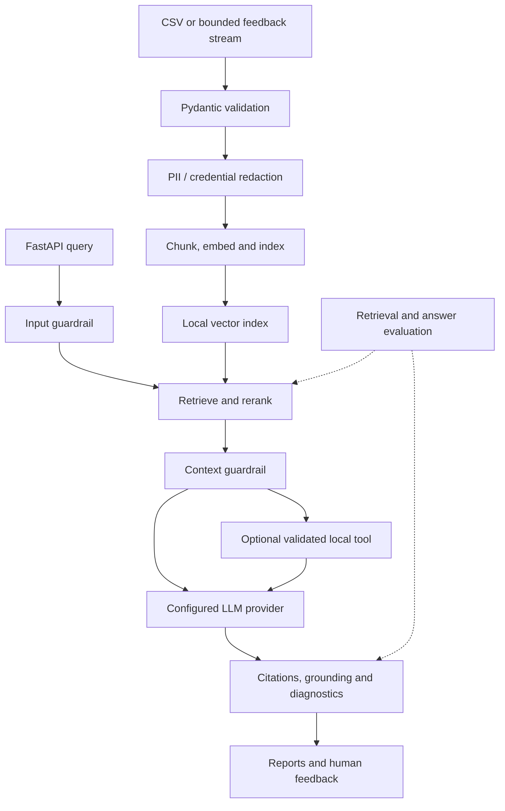
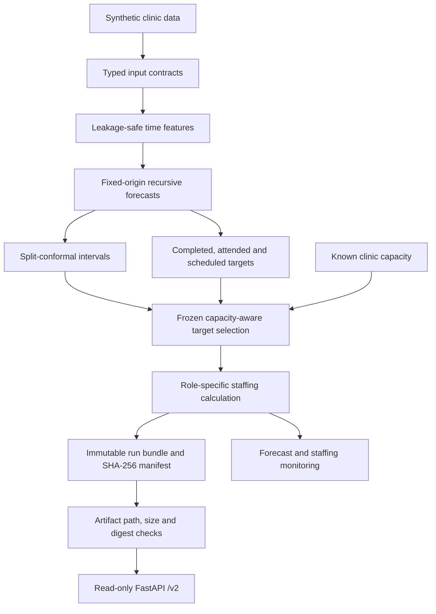
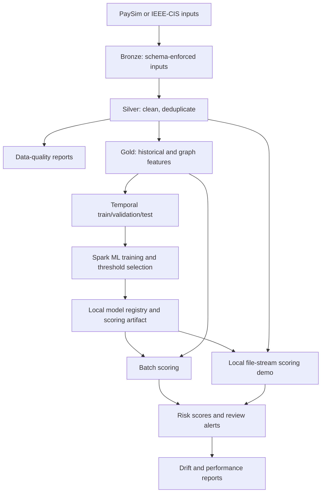

# ML systems: architecture and evidence

[Profile](README.md) · [Featured projects](FEATURED.md) · [Case studies](CASE_STUDIES.md) · [Methods](METHODS.md)

This page is an entry point for technical reviewers who want to follow a complete system from input data to a decision, service response or operational artifact. The diagrams are deliberately simplified; each is backed by the linked source code and project-specific architecture. They describe public portfolio implementations, not verified live deployments at a client.

## 1. Feedback intelligence: evidence-grounded answers

Question: how can unstructured customer feedback become inspectable answers without treating an LLM response as sufficient evidence?

- Engineering choice: deterministic local embeddings and LLM defaults make end-to-end evaluations reproducible without credentials. Optional hosted providers can be configured separately.
- What to inspect: [system design](https://github.com/DiogoRibeiro7/feedback-intelligence-agent/blob/main/docs/architecture.md), [agent orchestration](https://github.com/DiogoRibeiro7/feedback-intelligence-agent/blob/main/src/feedback_intelligence_agent/agent.py), [API](https://github.com/DiogoRibeiro7/feedback-intelligence-agent/blob/main/src/feedback_intelligence_agent/api.py), [evaluation contract](https://github.com/DiogoRibeiro7/feedback-intelligence-agent/blob/main/docs/evaluation.md), and [deployment scope](https://github.com/DiogoRibeiro7/feedback-intelligence-agent/blob/main/docs/deployment.md).
- Checks and failure boundaries: retrieval ranking, citation alignment, refusal correctness, prompt-injection guardrails, and typed API responses can be tested independently. Local JSON storage, regex-based redaction, and deployment templates do not establish multi-tenant production security or a fully operated cloud service.

## 2. Clinic forecasting: uncertainty becomes a staffing decision

Question: how do forecasts, uncertainty and operational capacity produce an auditable staffing recommendation rather than a score on a forecasting leaderboard?

- Engineering choice: batch calculations are separated from read-only serving. A frozen capacity-pressure rule selects the clinical target using forecast-time evidence; the API never recalculates staffing at request time.
- What to inspect: [architecture and rendered C4/sequence diagrams](https://github.com/DiogoRibeiro7/clinic-forecasting-platform/blob/main/docs/architecture.md), [hybrid policy](https://github.com/DiogoRibeiro7/clinic-forecasting-platform/blob/main/src/clinic_forecast/hybrid_policy.py), [run snapshots](https://github.com/DiogoRibeiro7/clinic-forecasting-platform/blob/main/src/clinic_forecast/serving_snapshot.py), [provenance verification](https://github.com/DiogoRibeiro7/clinic-forecasting-platform/blob/main/src/clinic_forecast/serving_provenance.py), and [10-minute demo](https://github.com/DiogoRibeiro7/clinic-forecasting-platform/blob/main/docs/demo_guide.md).
- Checks and failure boundaries: rolling-origin evaluation, conformal coverage, decision policy benchmarks, and artifact-integrity failures are independently inspectable. Staffing-benefit evidence comes from synthetic experiments. The system is not a clinically governed deployment; see its [production-readiness matrix](https://github.com/DiogoRibeiro7/clinic-forecasting-platform/blob/main/docs/production_readiness.md).

## 3. Transaction risk: temporal validation through alert monitoring

Question: how can transaction risk modelling preserve time order and review-capacity constraints through data processing, scoring and monitoring?

- Engineering choice: Spark transformations and temporal feature windows make data order explicit. The selected alert threshold can reflect review capacity or assumed economic costs, rather than using a classification default.
- What to inspect: [architecture and sequence diagram](https://github.com/DiogoRibeiro7/transaction-risk-lakehouse/blob/main/docs/architecture.md), [temporal split](https://github.com/DiogoRibeiro7/transaction-risk-lakehouse/blob/main/src/transaction_risk/models/split.py), [thresholding](https://github.com/DiogoRibeiro7/transaction-risk-lakehouse/blob/main/src/transaction_risk/models/thresholding.py), [streaming job](https://github.com/DiogoRibeiro7/transaction-risk-lakehouse/blob/main/src/transaction_risk/streaming/scoring_job.py), and [monitoring reports](https://github.com/DiogoRibeiro7/transaction-risk-lakehouse/blob/main/src/transaction_risk/monitoring/report.py).
- Checks and failure boundaries: the repository covers feature provenance, time-ordered splits, imbalanced evaluation, batch/stream scoring, and static drift reports. It uses local Spark and file-stream demonstrations; it does not include a production broker, cluster operations, pager integration or realistic delayed fraud labels. See [limitations](https://github.com/DiogoRibeiro7/transaction-risk-lakehouse/blob/main/docs/limitations.md).

## What the three systems demonstrate

| Concern | Feedback intelligence | Clinic forecasting | Transaction risk |
| :-- | :-- | :-- | :-- |
| Decision or output | Evidence-grounded response | Uncertainty-aware staffing recommendation | Capacity/cost-aware review alert |
| Critical contract | Guarded retrieval and citations | Fixed-origin forecasts and frozen policy | Historical features and temporal split |
| Engineering boundary | Validated FastAPI response and telemetry | Immutable batch artifact to read-only API | Bronze/silver/gold to batch and local stream scoring |
| Inspectable evaluation | Retrieval, groundedness and refusal metrics | Forecast, interval and decision benchmarks | PR-AUC, precision at K, costs and drift |
| Unverified real-world claim | Production service reliability | Clinical staffing improvement | Live fraud reduction at an institution |

Across all three, the pattern is not "use the most complex model". It is to specify the decision, protect the data and evaluation contract, expose assumptions, and connect a model to a testable interface or artifact. Working implementations, reproducible benchmarks and production deployment are different evidence levels; no diagram should collapse them into one claim.

For the modelling rationale and validation principles, continue to [Methods](METHODS.md). For problem-to-outcome narratives, see [Case Studies](CASE_STUDIES.md). For quantitative portfolio controls and reported professional outcomes, see [Statistics](STATISTICS.md).
